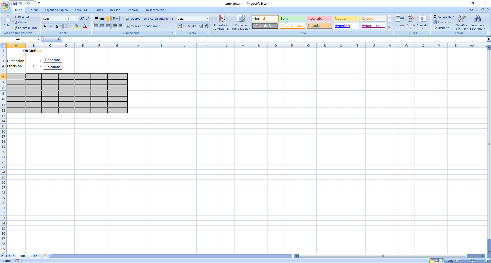
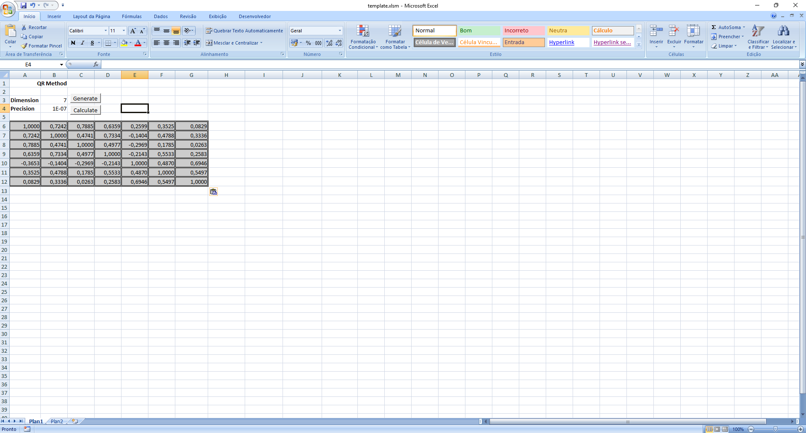
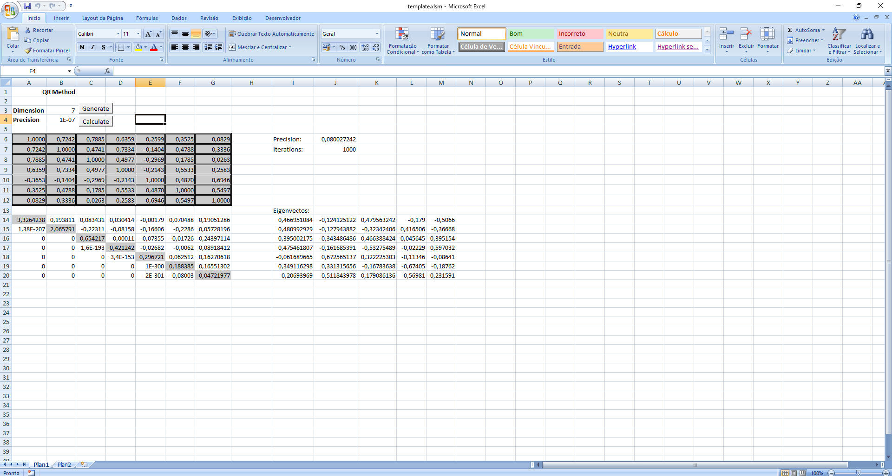

# Spreadsheet macros

This folder contains spreadsheet versions of the algorithms implemented in
[`src/autovalores/`](../src/autovalores/). They are kept here for reference
and to reproduce the original IC results.

Two environments are provided, with **independent implementations** of the
same algorithm:

| Folder | Environment | Language | Entry point |
|---|---|---|---|
| [`excel/`](excel/)            | Microsoft Excel | VBA | `Calcular` |
| [`libreoffice/`](libreoffice/)| LibreOffice Calc | LibreOffice Basic | `Calcular` |

Both compute the eigenvalues and eigenvectors of a small matrix using the
**QR method with Givens rotations** — the same algorithm as
[`src/autovalores/qr.py`](../src/autovalores/qr.py).

## How to use?

## Which one should I use?

- **Have Microsoft Excel?** → [`excel/`](excel/)
- **Have LibreOffice?** → [`libreoffice/`](libreoffice/)
- **Want to inspect or test the algorithm?** → use the Python version in
  [`src/autovalores/`](../src/autovalores/), which is covered by
  [`tests/test_reference.py`](../tests/test_reference.py).

## Important

The `.bas` extension is used by **both** dialects, but the runtime APIs are
different:

- VBA uses `Range`, `Cells`, `Interior.Color`.
- LibreOffice Basic uses `Cell(...)`, `REF(...)`, `CellBackColor` (from the
  external `LibreMacro` library).

**Do not copy the file from one folder into the other** — it will not run.

## Keeping the two versions in sync

The two macros are supposed to implement the **same** numerical algorithm.
If you fix a bug in one, mirror the fix in the other. The README inside
each folder lists the known issues and how they were handled.

## Reference values

All three implementations (Python, Excel, LibreOffice) should produce the
same eigenvalues for the matrices in
[`tests/reference_data.py`](../tests/reference_data.py). For example:

| Matrix | Eigenvalues |
|---|---|
| `[[3, -1, 0], [-1, 2, -1], [0, -1, 3]]` | `1, 3, 4` |
| `[[4, -2, -2], [0, 1, 0], [1, 0, 1]]`   | `1, 2, 3` |
| `[[3, 0, 1], [2, 2, 2], [4, 2, 5]]`     | `1, 2, 7` |
| `[[0, 1], [-1, 5]]`                     | `0.208712, 4.791288` |